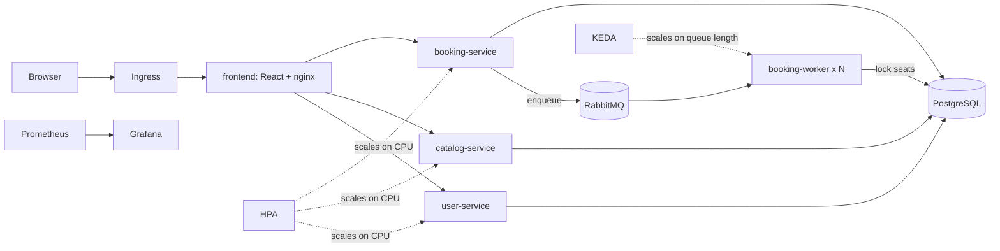

# TicketRush

Flash-sale ticket booking: waiting-room queue, atomic seat locking, autoscaling workers.
**Demo project: mock payments only, sample events are fictional, do not use real passwords.**

Live demo: [URL here]  |  Load-test report: [docs/LOAD_TEST_REPORT.md](docs/LOAD_TEST_REPORT.md)

## Architecture


## Features
Search events by city/category/text, seat map, signup/login (JWT), 5-minute seat holds, mock checkout, My bookings, flash-release countdown with live queue position, Control Room (queue, success rate, pods, scaling events), Prometheus + Grafana.

## Stack
FastAPI, React + Vite, PostgreSQL, RabbitMQ, Docker (amd64 + arm64), Kubernetes (Minikube / k3s), HPA + KEDA, Prometheus + Grafana, Locust, GitHub Actions + GHCR.

## Run locally (Docker Compose)
```powershell
copy .env.example .env
docker compose up --build --scale booking-worker=3
```
Site: http://localhost:3000. Tests: see `tests/` (`python -m pytest -v`).

## Run on Kubernetes (Minikube)
See `k8s/README.md`, then `docs/PART4.md` for monitoring and the load test, `docs/GO_LIVE.md` for going public.

## Repository map
`services/` APIs, `worker/` queue worker, `frontend/`, `db/init.sql`, `k8s/` manifests, `loadtest/` Locust + integrity check, `deploy/` production config, `.github/workflows/` CI, `docs/` notes.

## Screenshots
[add: home page, seat map, queue screen, Grafana during a rush, Control Room]

## Limitations (honest list)
RabbitMQ has no disk (queued bookings are lost if it restarts). One shared database for all services. Rate limiting is per pod and uses a forwardable IP header. Prometheus/Grafana keep no history across restarts. Payments are simulated. Sample data is fictional; poster art is generated.
